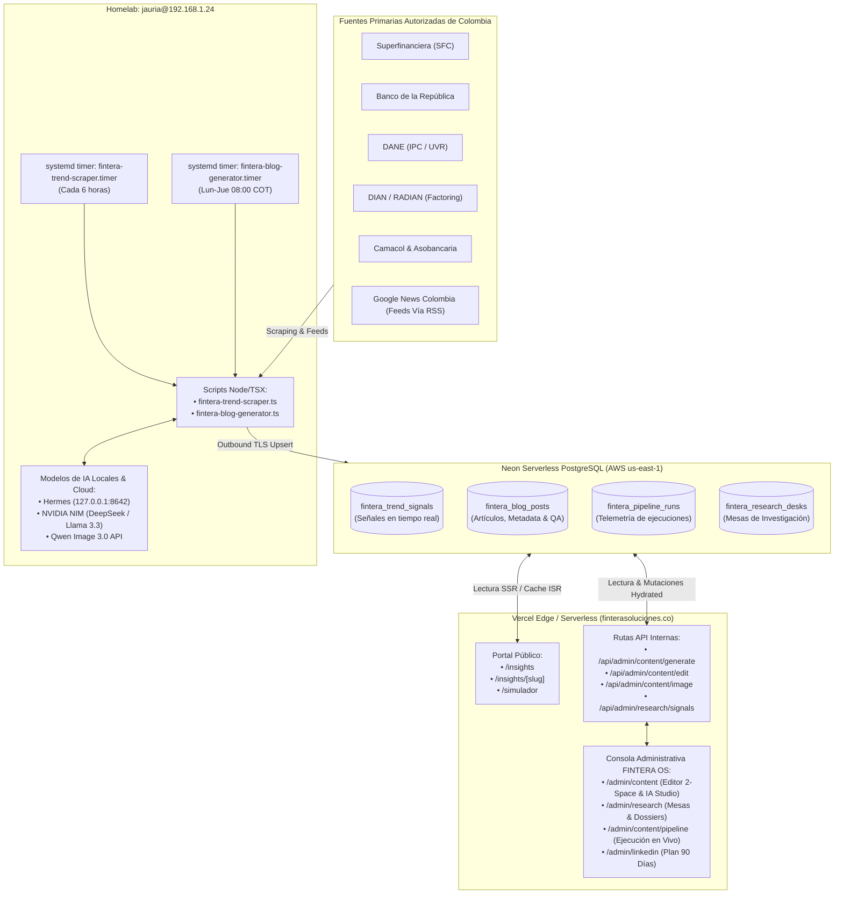
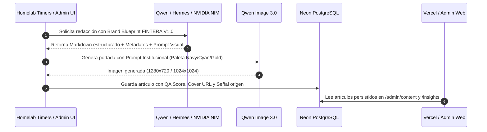

# FINTERA Architecture & Content OS Blueprint

> **Estado**: Producción Activa · **Versión**: 2.5 (Enterprise Dual-Theme + Homelab Hybrid)  
> **Corte Oficial**: Noviembre 2026 · **Workspace**: `packages/fintera-website`  
> **Host Homelab**: `jauria@192.168.1.24` · **Cloud Production**: Vercel (`finterasoluciones.co`)

---

## 1. Visión General y Objetivos del Sistema

FINTERA opera una arquitectura híbrida desacoplada entre **Frontend / Edge SSR (Vercel)** y un **Motor Autónomo de Inteligencia Financiera & Generación de Contenido (Homelab en `jauria@192.168.1.24`)**, respaldado por una base de datos distribuida en **Neon Serverless PostgreSQL**.

Este diseño resuelve tres desafíos críticos:
1. **Evitar limitaciones de serverless/timeouts en Vercel**: Los scrapers financieros, los análisis de tendencias multi-fuente y la generación de piezas de alta densidad junto con imágenes fotorrealistas con Qwen Image 3.0 toman entre 30 y 90 segundos. Ejecutarlos en serverless causaría cuellos de botella y costos prohibitivos.
2. **Máxima seguridad y cero exposición de puertos**: Los servicios del homelab empujan datos de manera **outbound** hacia Neon PostgreSQL mediante TLS. No se requieren túneles adicionales ni aperturas de puertos entrantes hacia el homelab.
3. **Consistencia Editorial y Gobernanza Estricta**: Cada artículo o señal pasa por una compuerta QA de 8 dimensiones antes de poder publicarse.

---

## 2. Diagrama de Arquitectura Global



---

## 3. Topología de Componentes

### 3.1. Base de Datos: Neon PostgreSQL (`ep-bitter-math-b896vfat` / `ep-shiny-surf-a43j7kxr`)
La aplicación utiliza Prisma ORM con esquemas idempotentes:
- **`fintera_trend_signals`**: Almacena las señales detectadas desde las 14 fuentes autorizadas y feeds RSS de Colombia.
- **`fintera_blog_posts`**: Artículos estructurados con soporte de Markdown nativo, slugs amigables, fechas de corte oficial, score QA de 8 dimensiones y referencias a imágenes creadas.
- **`fintera_pipeline_runs`**: Métricas de telemetría de ejecuciones periódicas (señales encontradas, tokens consumidos, estado de ejecución).
- **`lib/prisma.ts`**: Inicializador con fallback inteligente que asegura conexión contra pools activos (`FNT_NEXT_DATABASE_URL` o `DATABASE_URL`).

### 3.2. Homelab Engine (`jauria@192.168.1.24`)
Ubicación de despliegue: `/home/jauria/planmaestro-ecosystem/packages/fintera-website`

#### Timers de Systemd:
1. **`fintera-trend-scraper.timer`**:
   - Programación: Cada 6 horas (`*-*-* 00/6:15:00`).
   - Servicio ejecutado: `/home/jauria/scripts/run-fintera-trend-scraper.sh`.
   - Función: Barre feeds de SFC, BanRep, DIAN y Google News Colombia; evalúa relevancia por pilares y hace `upsert` en `fintera_trend_signals`.
2. **`fintera-blog-generator.timer`**:
   - Programación: Lunes a Jueves a las 08:00 COT (`Mon..Thu *-*-* 08:00:00`).
   - Servicio ejecutado: `/home/jauria/scripts/run-fintera-blog-generator.sh`.
   - Función: Detecta señales relevantes no procesadas, redacta borradores estructurados con citas oficiales, genera prompts y portadas fotorrealistas con Qwen Image 3.0 y evalúa el QA Gate.

#### Logs y Monitoreo en Homelab:
- Logs de usuario: `/home/jauria/.local/log/fintera-trend-scraper.log` y `fintera-blog-generator.log`
- Comandos de diagnóstico rápido:
  ```bash
  systemctl --user list-timers --all | grep fintera
  journalctl --user -u fintera-trend-scraper.service -n 50 --no-pager
  ```

---

## 4. Pipeline de Generación de Contenido e Imágenes



### Reglas Visuales Obligatorias para Prompts (Qwen Image 3.0)
- **Concepto Rector**: *"Señales de claridad"* en el sistema financiero colombiano.
- **Paleta Institucional**: Azul Marino Profundo (`#0A2342`), Cyan Neón / Turquesa (`#00C4B3`) y Acento Oro Cálido (`#FFD447`).
- **Restricciones Negativas**: Prohibido el uso de apretones de manos genéricos corporativos, billetes físicos exagerados, cerditos de alcancía, flechas de crecimiento trilladas o fotos de stock sin contexto de negocio.
- **Portadas por Artículo**: Cada artículo cuenta con una portada fotográfica o analítica única generada para su temática específica, evitando reciclar una misma imagen para toda la categoría.

---

## 5. Arquitectura del Panel Administrativo (UI/UX Dual-Theme)

El panel administrativo (`/admin/*`) cuenta con un diseño de cristal institucional (*glassmorphism*) con soporte completo para **Modo Claro (Alabastro y Azul Zafiro)** y **Modo Oscuro (Navy Ejecutivo y Cyan)**:

### Rutas Clave:
1. **`/admin/content`**:
   - **Disposición Vertical de 2 Espacios (`lg:col-span-12`)**:
     - Arriba: Inspector Activo de Artículo, Compuerta de QA de 8 dimensiones, tabs de *Vista Formateada*, *Reescribir con IA*, *Pieza Gráfica / Portada IA* y *Editor Manual Markdown*.
     - Abajo: Tabla completa de *Repositorio FINTERA Insights* a ancho completo, eliminando scrollbars horizontales forzados.
2. **`/admin/research`**:
   - Monitoreo en vivo de las 14 fuentes autorizadas colombianas.
   - 4 Mesas de Investigación Estratégica con generación de *Dossiers Oficiales* renderizados con formato Markdown dinámico (`MarkdownRenderer`).
   - Contador de señales persistente sincronizado contra `prisma.trendSignal`.
3. **`/admin/content/pipeline`**:
   - Disparador manual para el Scraper Financiero y el Generador Autónomo con streaming de consola en vivo.
4. **`/admin/linkedin`**:
   - Matriz de conversión y calendario editorial de 90 días, con generador de carruseles PDF optimizados para LinkedIn (1080×1350).

---

## 6. Guía de Operaciones y Resolución de Incidencias

### 6.1. ¿Por qué no se necesita un nuevo túnel de Cloudflare?
En la arquitectura de PlanMaestro / Apex, Cloudflare Tunnels se utiliza para tráfico **inbound** hacia servicios que exponen APIs HTTP locales (por ejemplo, `api.apexaisolutions.dev` apuntando a `apex-backend.service:3002`).  
Para FINTERA, las operaciones pesadas en el homelab son procesos cliente que extraen información pública de la web y escriben **directamente hacia la base de datos Neon vía TLS (puerto 5432)**. Por lo tanto, no hay puertos abiertos ni endpoints entrantes que requieran un nuevo daemon `cloudflared`.

### 6.2. Sincronización Manual y Verificación
Si se requiere forzar una ejecución manual desde el servidor homelab:
```bash
# Conectarse al homelab
ssh jauria@192.168.1.24

# Ejecutar el scraper de tendencias manualmente
/home/jauria/scripts/run-fintera-trend-scraper.sh

# Ejecutar el generador de artículos e imágenes
/home/jauria/scripts/run-fintera-blog-generator.sh
```

### 6.3. Sincronización de Base de Datos ante cambios de esquema
Para aplicar adiciones al esquema de Prisma en Neon sin alterar datos existentes:
```bash
npx prisma migrate diff --from-url "$FNT_NEXT_DATABASE_URL_UNPOOLED" --to-schema-datamodel prisma/schema.prisma --script
```
Execute las sentencias aditivas en `prisma/schema.prisma` asegurando nunca ejecutar sentencias destructivas (`DROP TABLE` / `DROP COLUMN`).

---

## 7. Dossiers Mensuales Automatizados y Expansión Enterprise de `/admin/research`

La consola `/admin/research` opera bajo tres módulos integrados con persistencia en Neon PostgreSQL:

1. **Tab 1 · 14 Fuentes Autorizadas (`SOURCES_14`)**:
   - Buscador instantáneo + filtro por pilar estratégico y por nivel institucional (Oficiales Colombia, Gremiales, Multilaterales).
   - Telemetría en vivo por fuente (`X señales capturadas`, estado `Monitor Activo · TLS 200 OK`), botón de barrido quirúrgico individual (**"Barrer Fuente Ahora"**) y acceso directo (**"Ver Señales de esta Fuente"**).
2. **Tab 2 · Señales y Tendencias Capturadas (`SIGNALS_FEED`)**:
   - Barra multifiltro por fuente oficial, pilar, velocidad (`HIGH_VELOCITY >= 85`, `EMERGING`, `STABLE`), estado (`RAW` vs `DECOMPOSED`) y búsqueda libre.
   - Selector de formato editorial (`BLOG_POST`, `WHITEPAPER`, `CASE_STUDY`, `GUIDE`) integrado junto al botón **"Desarrollar Pieza FINTERA"**.
3. **Tab 3 · 4 Mesas de Investigación y Dossiers Mensuales (`DESKS_AND_BRIEFS`)**:
   - Títulos inequívocos con periodo de edición y versión (`[Noviembre 2026 · v2] Mesa 2: ...`) persistidos en `fintera_pipeline_runs` (`pipelineType = "MONTHLY_DOSSIER"`).
   - **Programador Mensual en Homelab (`fintera-monthly-dossier.timer`)**: Ejecuta `scripts/fintera-monthly-dossier.ts` el día 1 de cada mes a las `06:00 COT` en `jauria@192.168.1.24`.
   - Acciones ejecutivas por Dossier: **Publicar como Whitepaper en `/insights`**, **Enviar por Boletín Ejecutivo (Resend)** y **Descargar Dossier (`.md`)**.

---

## 8. Motor de Analítica Editorial, Contador de Lecturas y Difusión Social (OpenGraph + UTM)

Cada artículo publicado en `/insights/[slug]` incorpora telemetría en tiempo real y atribución multicanal:

- **Endpoint de Telemetría (`/api/insights/telemetry`)**:
  - Registra visualizaciones deduplicadas por sesión (`VIEW`), votos de utilidad (`HELPFUL`), clics en CTAs (`CTA_CLICK`) y compartidos por canal (`SHARE`: `whatsapp`, `linkedin`, `x`, `email`, `copy`).
  - Sincroniza atómicamente en Neon PostgreSQL (`fintera_blog_posts.complianceJson`).
- **Barra de Difusión Social (`components/fintera/article-engagement-bar.tsx`)**:
  - Botones nativos para **WhatsApp**, **LinkedIn**, **X (Twitter)**, **Correo** y **Copiar Enlace** con parámetros `utm_source`, `utm_medium=social_share` y `utm_campaign`.
- **Metadatos OpenGraph y Twitter Cards (`generateMetadata`)**:
  - Cada artículo expone `og:type = article`, `twitter:card = summary_large_image`, URL canónica y la imagen única generada por Qwen Image 3.0 para previsualizaciones enriquecidas en LinkedIn, WhatsApp y Meta.

---

## 9. Gobernanza Google E-E-A-T (YMYL) y Boletín Ejecutivo vía Resend

Para proteger y potenciar el posicionamiento orgánico en Google frente a las políticas de *Scaled Content Abuse* en temas financieros (**YMYL — Your Money or Your Life**):

1. **Compuerta de Curaduría Humana y `Nota de Criterio Experto en Mesa` (`humanReview`)**:
   - Cada artículo incluye una **Nota de Criterio Experto en Mesa** redactada/validada por especialistas de FINTERA (Comité de Crédito Hipotecario Ley 546 y Mesa de Estructuración RADIAN/Factoring), aportando *Information Gain* real que un LLM genérico no posee.
   - En `/admin/content` (pestaña **`Sello Humano E-E-A-T & Analítica`**), el equipo puede editar la nota experta, certificar el revisor humano y emitir un hash de verificación (`FNT-EEAT-...`).
2. **Datos Estructurados `Schema.org AnalysisNewsArticle` (`application/ld+json`)**:
   - Inyectados automáticamente en `/insights/[slug]` con `author`, `reviewedBy` (revisor humano certificado), `citation` (las fuentes primarias oficiales SFC, BanRep, DANE, DIAN, OCDE), `publishingPrinciples` y `interactionStatistic`.
3. **Boletín Ejecutivo FINTERA Insights vía Resend (`/api/insights/newsletter`)**:
   - Captura suscriptores desde cada artículo (segmentados en Vivienda B2C, Liquidez B2B o Ejecutivos) y despacha boletines ejecutivos y Dossiers Mensuales mediante `ResendNotificationService` con respaldo en el Outbox Transaccional (`domain_outbox_events`).


---

## 10. Corrección acotada de calendario LinkedIn y carrusel (2026-11-19)

**LOCAL_GO_WITH_DISCLOSED_LIMITS — verificación local aprobada; commit, publicación y aceptación humana de esta corrección pendientes al corte.** Se conserva la arquitectura y no se añade esquema. El calendario identifica cada espacio por año, mes, semana y día (`cal_YEAR_mMONTH_wWEEK_day`). Un título, slug o día/semana coincidente no acredita el periodo de una pieza histórica; las asociaciones ambiguas permanecen sin asignar. Una reserva en desarrollo, fallida o sin contenido confirmado no se presenta ni exporta como artículo terminado, incluso si se abre desde otra consola editorial. Un borrador con contenido real puede seguir previsualizándose. Un intento interrumpido que permanezca `PENDING` no se resuelve necesariamente al recargar: requiere reconciliación o revisión editorial/operador; no se dispara una nueva generación pagada automáticamente. La lectura del catálogo alojado confirmó compatibilidad, sin requerir DDL ni cambios de artículos alojados para esta corrección.

El estudio usa `components/fintera/growth/LinkedinCarouselPdfModal.tsx` y estilos locales `linkedin-carousel.css`. Se retiran por completo el gradiente azul de pantalla/impresión y la malla luminosa de la vista previa. Los seis fondos originales se conservan sin editar. El tono del texto pertenece a cada imagen conocida: fondos 1/5/6 oscuros y 2/3/4 claros, con paletas correspondientes en vista previa y PDF. Cuerpo, títulos, marca, notas y etiquetas conservan contraste sin añadir un nuevo scrim; las imágenes claras no reciben sombras de texto. Los controles del modal usan variables del tema administrativo, separadas del color del arte.

El cierre separa el enlace semántico al artículo exacto y su destino legible, la acción al simulador y la nota de privacidad con referencia a Ley 1581/Habeas Data. Los enlaces conservan sus `href` completos y UTM, sin imprimir el slug largo dentro del párrafo. La prosa se justifica con última línea normal; títulos y enlaces quedan a la izquierda. La impresión espera a las imágenes de fondo además de logos/fuentes. No hay envío a LinkedIn ni publicación editorial automática desde la exportación.

QA congeló 442 fuentes/activos en HEAD `7db1f1910755f2f361034c4f6265281c8607357e`, manifest SHA256 `c74581c5667a03191069e0d9aedd32a8e863a6c19e20ba80be53734e748e75e4`. El informe de marca previamente modificado, los seis PNG ajenos y la entrada de biblioteca bancaria permanecen fuera de este cambio. La decisión independiente `PASS_LOCAL_LINKEDIN_CALENDAR_CAROUSEL_R1_QUALIFIED` (`allChecksPass: true`) enlaza **323 fuentes**, agregado SHA256 `4b70dd0275ce7cc71811e4083e0afec1c89a91bc369030089c4dbf800d94dda4`, y build `37-drlGLqnKf5uv6ogyYD`. TypeScript, lint estricto de ocho fuentes y build Next pasaron sin deriva. QA confirmó 13 grupos lógicos backend (15 ejecuciones, dos repetidas), siete recorridos lógicos de navegador y cuatro vistas del modal completo —claro/oscuro, 375/1440— con cero infracciones axe reportadas y desplazamiento real del copy mediante teclado. Las pruebas de handler usan PostgreSQL aislado real y proveedor/autorizador externos sintéticos; no una sesión Clerk genuina ni generación pagada.

El PDF real tiene seis páginas, enlaces clicables al artículo exacto y simulador, privacidad separada y prosa justificada sin recorte/desbordamiento. La comparación de seis muestras por imagen dio diferencia RGB máxima cero frente al fondo sin capa, conservando los bytes originales. CSS mantiene `1080×1350`; Chromium 156 produjo MediaBox `810×1013.03998 pt` (`1080×1350.72 CSS px`), cuantización de altura aceptada explícitamente, sin afirmar una dimensión física exacta inexistente. El PDF/capturas finales preceden sólo a los tres atributos de accesibilidad del copy: el cambio inverso reproduce exactamente su hash, sin alterar impresión/estilo/contenido; las cuatro pruebas de teclado/axe usan la fuente final.

Se conservan los fallos originales, incluidos blanco sobre fondo claro, contraste del copy y foco del área desplazable, además de correcciones de fixtures/selector/conteo. Axe no certifica contraste sobre imágenes; Los agentes QA y coordinador inspeccionaron visualmente las vistas claro/oscuro y el PDF. No se certifica WCAG universal, publicación en LinkedIn, sesión alojada autenticada ni aceptación humana operativa. El hook ordinario offline conservó el grafo al rechazar una reducción; no se forzó reconstrucción ni se usa como certificado semántico.

Recibos bajo el directorio externo siguiente: `qa/final-independent-decision.json`, SHA256 `5fbe0b1493950e2b4e0c00630214f05139bd97538a9cb237932b1319315a3eed`; `publication/final-build-receipt.json`, SHA256 `d85e7ed82e3457ec840e84fd193c84cbe9919fd30cb5dce57f0a2335dee6c8a8`; `qa/carousel-caption-final.pdf`, SHA256 `c15d71a4183346034fa1112e18d59da1711c54e51c136d4e1c68162c219772db`; `qa/caption-keyboard-final-results.json` y `qa/normalized-test-results.json`. Los procesos locales propios de QA se detuvieron y sus evidencias permanecen conservadas.

Evidencia y tareas atómicas: `~/.local/share/fintera-linkedin-calendar-carousel/20261119/control/`. Las pruebas editoriales locales requieren un suplemento DDL limitado derivado de la fuente congelada, porque la cadena de once migraciones no crea las tablas de contenido no gestionadas. Ese suplemento sólo pertenece al PostgreSQL aislado de QA: no es un cambio de ledger, `db push` ni recomendación de DDL alojado. Mission Control, memoria vectorial y telemetría exacta no están disponibles; tokens y coste son `null`.

## 11. Activación de clientes y solicitud de servicio

El recorrido público `/solicitar` → cuenta de Clerk → `/onboarding/solicitud` registra una `CustomerServiceRequest` propia del cliente, con solicitud de servicio y tratamiento de datos aceptados por separado. Esta entidad no crea un `Client`, un expediente de crédito ni permisos documentales por el hecho de registrarse o enviar la solicitud. `/portal` muestra su estado de forma independiente; los documentos conservan la vinculación y autorización del expediente existente. El detalle de interfaz, contratos, contacto oficial, constancia y calificación del código está en [FINTERA_CUSTOMER_ONBOARDING_R1.md](./FINTERA_CUSTOMER_ONBOARDING_R1.md). Los recibos de publicación y aceptación real se conservan por separado del corte de código.
