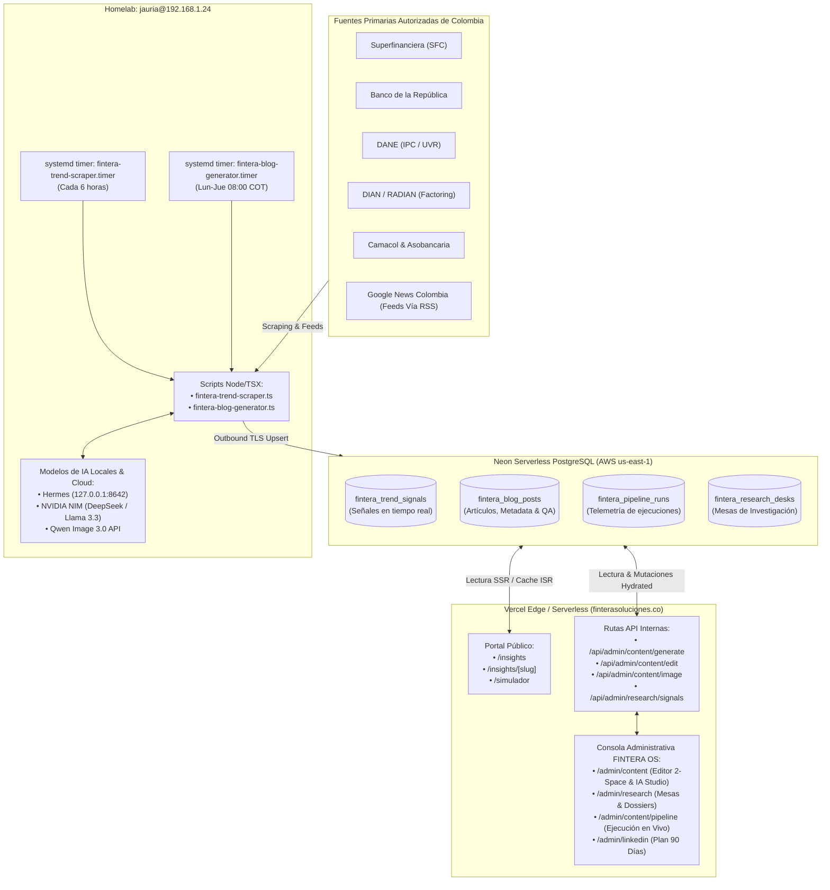
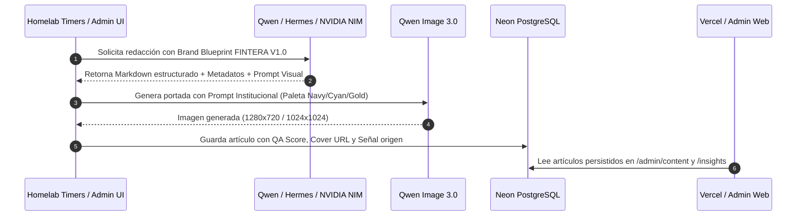

# FINTERA Architecture & Content OS Blueprint

> **Estado**: Producción Activa · **Versión**: 2.5 (Enterprise Dual-Theme + Homelab Hybrid)  
> **Corte Oficial**: Noviembre 2026 · **Workspace**: `packages/fintera-website`  
> **Host Homelab**: `jauria@192.168.1.24` · **Cloud Production**: Vercel (`finterasoluciones.co`)

---

## 1. Visión General y Objetivos del Sistema

FINTERA opera una arquitectura híbrida desacoplada entre **Frontend / Edge SSR (Vercel)** y un **Motor Autónomo de Inteligencia Financiera & Generación de Contenido (Homelab en `jauria@192.168.1.24`)**, respaldado por una base de datos distribuida en **Neon Serverless PostgreSQL**.

Este diseño resuelve tres desafíos críticos:
1. **Evitar limitaciones de serverless/timeouts en Vercel**: Los scrapers financieros, los análisis de tendencias multi-fuente y la generación de piezas de alta densidad junto con imágenes fotorrealistas con Qwen Image 3.0 toman entre 30 y 90 segundos. Ejecutarlos en serverless causaría cuellos de botella y costos prohibitivos.
2. **Máxima seguridad y cero exposición de puertos**: Los servicios del homelab empujan datos de manera **outbound** hacia Neon PostgreSQL mediante TLS. No se requieren túneles adicionales ni aperturas de puertos entrantes hacia el homelab.
3. **Consistencia Editorial y Gobernanza Estricta**: Cada artículo o señal pasa por una compuerta QA de 8 dimensiones antes de poder publicarse.

---

## 2. Diagrama de Arquitectura Global



---

## 3. Topología de Componentes

### 3.1. Base de Datos: Neon PostgreSQL (`ep-bitter-math-b896vfat` / `ep-shiny-surf-a43j7kxr`)
La aplicación utiliza Prisma ORM con esquemas idempotentes:
- **`fintera_trend_signals`**: Almacena las señales detectadas desde las 14 fuentes autorizadas y feeds RSS de Colombia.
- **`fintera_blog_posts`**: Artículos estructurados con soporte de Markdown nativo, slugs amigables, fechas de corte oficial, score QA de 8 dimensiones y referencias a imágenes creadas.
- **`fintera_pipeline_runs`**: Métricas de telemetría de ejecuciones periódicas (señales encontradas, tokens consumidos, estado de ejecución).
- **`lib/prisma.ts`**: Inicializador con fallback inteligente que asegura conexión contra pools activos (`FNT_NEXT_DATABASE_URL` o `DATABASE_URL`).

### 3.2. Homelab Engine (`jauria@192.168.1.24`)
Ubicación de despliegue: `/home/jauria/planmaestro-ecosystem/packages/fintera-website`

#### Timers de Systemd:
1. **`fintera-trend-scraper.timer`**:
   - Programación: Cada 6 horas (`*-*-* 00/6:15:00`).
   - Servicio ejecutado: `/home/jauria/scripts/run-fintera-trend-scraper.sh`.
   - Función: Barre feeds de SFC, BanRep, DIAN y Google News Colombia; evalúa relevancia por pilares y hace `upsert` en `fintera_trend_signals`.
2. **`fintera-blog-generator.timer`**:
   - Programación: Lunes a Jueves a las 08:00 COT (`Mon..Thu *-*-* 08:00:00`).
   - Servicio ejecutado: `/home/jauria/scripts/run-fintera-blog-generator.sh`.
   - Función: Detecta señales relevantes no procesadas, redacta borradores estructurados con citas oficiales, genera prompts y portadas fotorrealistas con Qwen Image 3.0 y evalúa el QA Gate.

#### Logs y Monitoreo en Homelab:
- Logs de usuario: `/home/jauria/.local/log/fintera-trend-scraper.log` y `fintera-blog-generator.log`
- Comandos de diagnóstico rápido:
  ```bash
  systemctl --user list-timers --all | grep fintera
  journalctl --user -u fintera-trend-scraper.service -n 50 --no-pager
  ```

---

## 4. Pipeline de Generación de Contenido e Imágenes



### Reglas Visuales Obligatorias para Prompts (Qwen Image 3.0)
- **Concepto Rector**: *"Señales de claridad"* en el sistema financiero colombiano.
- **Paleta Institucional**: Azul Marino Profundo (`#0A2342`), Cyan Neón / Turquesa (`#00C4B3`) y Acento Oro Cálido (`#FFD447`).
- **Restricciones Negativas**: Prohibido el uso de apretones de manos genéricos corporativos, billetes físicos exagerados, cerditos de alcancía, flechas de crecimiento trilladas o fotos de stock sin contexto de negocio.
- **Portadas por Artículo**: Cada artículo cuenta con una portada fotográfica o analítica única generada para su temática específica, evitando reciclar una misma imagen para toda la categoría.

---

## 5. Arquitectura del Panel Administrativo (UI/UX Dual-Theme)

El panel administrativo (`/admin/*`) cuenta con un diseño de cristal institucional (*glassmorphism*) con soporte completo para **Modo Claro (Alabastro y Azul Zafiro)** y **Modo Oscuro (Navy Ejecutivo y Cyan)**:

### Rutas Clave:
1. **`/admin/content`**:
   - **Disposición Vertical de 2 Espacios (`lg:col-span-12`)**:
     - Arriba: Inspector Activo de Artículo, Compuerta de QA de 8 dimensiones, tabs de *Vista Formateada*, *Reescribir con IA*, *Pieza Gráfica / Portada IA* y *Editor Manual Markdown*.
     - Abajo: Tabla completa de *Repositorio FINTERA Insights* a ancho completo, eliminando scrollbars horizontales forzados.
2. **`/admin/research`**:
   - Monitoreo en vivo de las 14 fuentes autorizadas colombianas.
   - 4 Mesas de Investigación Estratégica con generación de *Dossiers Oficiales* renderizados con formato Markdown dinámico (`MarkdownRenderer`).
   - Contador de señales persistente sincronizado contra `prisma.trendSignal`.
3. **`/admin/content/pipeline`**:
   - Disparador manual para el Scraper Financiero y el Generador Autónomo con streaming de consola en vivo.
4. **`/admin/linkedin`**:
   - Matriz de conversión y calendario editorial de 90 días, con generador de carruseles PDF optimizados para LinkedIn (1080×1350).

---

## 6. Guía de Operaciones y Resolución de Incidencias

### 6.1. ¿Por qué no se necesita un nuevo túnel de Cloudflare?
En la arquitectura de PlanMaestro / Apex, Cloudflare Tunnels se utiliza para tráfico **inbound** hacia servicios que exponen APIs HTTP locales (por ejemplo, `api.apexaisolutions.dev` apuntando a `apex-backend.service:3002`).  
Para FINTERA, las operaciones pesadas en el homelab son procesos cliente que extraen información pública de la web y escriben **directamente hacia la base de datos Neon vía TLS (puerto 5432)**. Por lo tanto, no hay puertos abiertos ni endpoints entrantes que requieran un nuevo daemon `cloudflared`.

### 6.2. Sincronización Manual y Verificación
Si se requiere forzar una ejecución manual desde el servidor homelab:
```bash
# Conectarse al homelab
ssh jauria@192.168.1.24

# Ejecutar el scraper de tendencias manualmente
/home/jauria/scripts/run-fintera-trend-scraper.sh

# Ejecutar el generador de artículos e imágenes
/home/jauria/scripts/run-fintera-blog-generator.sh
```

### 6.3. Sincronización de Base de Datos ante cambios de esquema
Para aplicar adiciones al esquema de Prisma en Neon sin alterar datos existentes:
```bash
npx prisma migrate diff --from-url "$FNT_NEXT_DATABASE_URL_UNPOOLED" --to-schema-datamodel prisma/schema.prisma --script
```
Execute las sentencias aditivas en `prisma/schema.prisma` asegurando nunca ejecutar sentencias destructivas (`DROP TABLE` / `DROP COLUMN`).
